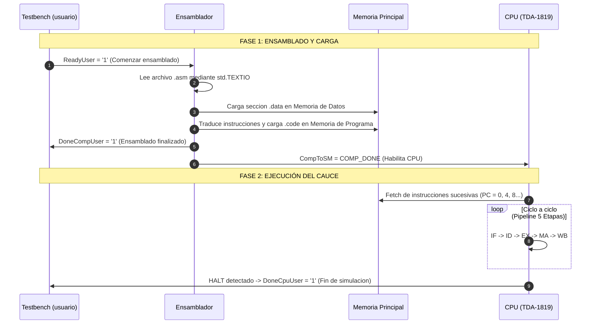

# INFORME TÉCNICO Y RESUMEN EJECUTIVO DE ARQUITECTURA
## Sistema Computacional TDA-1819 & Procesador Segmentado DLX/MIPS
### *Guía Maestra de Estudio y Comprensión del Sistema para Expositores*

---

## 1. VISIÓN GENERAL Y PROPÓSITO DEL SISTEMA

El proyecto **TDA-1819** es un emulador y sintetizador de arquitectura de computadoras en VHDL (estándar IEEE 1076-2002) desarrollado para la cátedra de *Taller de Arquitectura de Computadoras*.
El sistema implementa una **computadora completa mononúcleo (PC)** basada en una arquitectura tipo **Harvard** y filosofía **RISC (Load/Store)**, estrechamente emparentada con el estándar educativo **DLX / MIPS**.

### Capacidades Clave del Sistema:
1. **Ensamblado Integrado en VHDL:** No requiere un compilador externo en C o Python. El propio hardware emulado lee un archivo fuente en texto plano (`.asm`), realiza el análisis léxico-sintáctico, genera código de máquina y carga las memorias.
2. **Arquitectura Harvard Desacoplada:** Canales físicos independientes para Memoria de Instrucciones (ROM/RAM de programa) y Memoria de Datos (RAM de variables y pila).
3. **Cauce Segmentado (Pipelining) de 5 Etapas Clásicas:** IF, ID, EX, MA, WB.
4. **Control de Riesgos (Hazard Detection Unit):** Detección estructural de riesgos RAW (Read After Write), WAW (Write After Write), atascos de control por saltos (Branch/Jump) y colisiones en memoria.
5. **Mecanismo de Cortocircuito (Forwarding):** Bypass combinacional de operandos para evitar burbujas de atasco.

---

## 2. MAPA DE JERARQUÍA E INTERCONEXIÓN ESTRUCTURAL

El sistema se organiza en capas concéntricas estrictamente modulares. Para defender el trabajo, cada presentador debe visualizar la siguiente jerarquía de cajas negras:

```
[USUARIO] (usuario.vhd) -> Testbench principal
   │
   └── [PC] (pc.vhd) -> Computadora completa
        ├── 1. [ENSAMBLADOR] (ensamblador.vhd) -> Parser y cargador de código
        ├── 2. [BUSES_ADMIN] (buses_admin.vhd) -> Multiplexor de buses de sistema
        ├── 3. [MEMORIA] (memoria.vhd) -> Memoria Principal (Programa + Datos)
        └── 4. [CPU] (cpu.vhd) -> Procesador TDA-1819
             ├── UI (ui.vhd) -> Máquina de estados maestra y registros FP
             ├── RELOJ (reloj.vhd) -> Generador de fase y sincronismo
             ├── REGISTROS (registros.vhd) -> Banco de 32 Registros Enteros (R0..R31)
             ├── CPU_ADMIN (cpu_admin.vhd) -> Habilitadores de avance de etapas
             ├── PIPELINE_REGISTROS (pipeline_registros.vhd) -> Registros inter-etapa
             ├── ATASCOS (atascos.vhd) -> Detección de riesgos (RAW, WAW, Estr.)
             └── ETAPAS (etapas.vhd) -> Las 5 fases del pipeline
                  ├── 1. FETCH (fetch.vhd) -> PC y lectura de instrucción
                  ├── 2. DECODE (decode.vhd) -> Decodificación y lectura de operandos
                  ├── 3. EXECUTE (execute.vhd) -> ALU entera y FPU punto flotante
                  │    ├── ALU (execute_alu.vhd) -> Operaciones aritmético-lógicas + MUX Forwarding
                  │    └── FPU (execute_fpu.vhd) -> Operaciones FP multiciclo
                  ├── 4. MEMORY ACCESS (memory_access.vhd) -> Carga (lw) y Almacenamiento (sw)
                  └── 5. WRITEBACK (writeback.vhd) -> Escritura final en banco de registros
```

---

## 3. CICLO DE VIDA COMPLETO: ¿CÓMO SE EJECUTA EL CÓDIGO ASSEMBLER?

Un concepto fundamental que los evaluadores suelen indagar es: **"¿En qué momento se lee el archivo .asm y cómo llega a ejecutarse en la CPU?"**

La ejecución ocurre en **dos fases secuenciales gobernadas por señales de sincronización**:



### Fase 1: Ensamblado y Precarga (Handshake Inicial)
1. El usuario inicia la simulación en `usuario.vhd`, pasando como generic el nombre del archivo (ej. `ProgName => "prog_test1_raw_load_alu.asm"`).
2. Se activa la señal `ReadyUser <= '1'`.
3. El componente `ensamblador` abre el archivo en disco mediante el paquete estándar `std.TEXTIO`.
4. **Análisis de `.data`:** Lee constantes numéricas, vectores o cadenas ASCII, asignándoles direcciones físicas en la memoria de datos (`DataMem`).
5. **Análisis de `.code`:** Lee cada mnemónico (`lw`, `dadd`, `sw`, `halt`), genera la palabra binaria de 32 bits según el formato de instrucción (Tipo R, Tipo I, Tipo J) y la escribe en la memoria de programa (`InstMem`).
6. Al finalizar, el ensamblador pone `DoneCompUser <= '1'` y activa `CompToSM <= COMP_DONE`.

### Fase 2: Ejecución del Procesador
1. La máquina de estados principal (`UI / states_machine.vhd`) detecta `CompToSM = COMP_DONE` y pasa del estado inactivo al estado de ejecución.
2. Comienza a oscilar el reloj de etapas generado en `reloj.vhd`.
3. El PC (Program Counter) arranca en la dirección 0x0000 y el pipeline comienza a llenarse instrucción por instrucción.
4. Cuando la instrucción `halt` llega a la etapa WriteBack, la CPU detiene el reloj y emite la señal `DoneCpuUser <= '1'`, concluyendo la simulación.

---

## 4. ANATOMÍA DETALLADA DE LAS 5 ETAPAS DEL PIPELINE

Cada etapa posee su propia entidad en `Usuario/PC/2. CPU/2. Etapas/`:

### 1. Etapa IF (Instruction Fetch - `fetch.vhd`)
- **Misión:** Buscar la instrucción apuntada por el contador de programa.
- **Componentes clave:** Registro PC, sumador de incremento ($PC + 4$) y multiplexor para saltos tomados (Branch/Jump provenientes de ID o EX).
- **Control:** Si la unidad de atascos activa un `Stall`, el registro PC y el registro IF/ID se congelan (no avanzan).

### 2. Etapa ID (Instruction Decode - `decode.vhd`)
- **Misión:** Decodificación del código de operación, lectura sincrónica de los registros fuente ($Rs, Rt$) desde `registros.vhd`, extensión de signo para inmediatos y **detección de riesgos**.
- **Generación de señales de control:** Emite una estructura de registros (`execute_record`) hacia EX conteniendo la operación a realizar, los datos de operandos y los identificadores de registros involucrados (`reg_op1`, `reg_op2`, `RegDest`).
- **Gestión de atascos:** Si la unidad de atascos (`atascos.vhd`) detecta una dependencia RAW insalvable, inyecta una burbuja (NOP) hacia la etapa EX y mantiene congelada la etapa IF y el registro PC.

### 3. Etapa EX (Execute - `execute.vhd`)
- **Misión:** Ejecución de operaciones matemáticas y cómputo de direcciones efectivas.
- **Subcomponentes:**
  - `execute_alu.vhd`: ALU entera para sumas (`dadd`, `daddi`), restas (`dsub`), comparaciones (`slt`), operaciones lógicas (`and`, `or`, `xor`) y cálculo de dirección base + desplazamiento para cargas/almacenamientos.
  - `execute_fpu.vhd`: Unidad de Coma Flotante multiciclo para operaciones `addf`, `subf`, `mulf`, `divf`.
- **Mecanismo de Forwarding (Nuestra modificación):** En la entrada de la ALU se encuentran los multiplexores de cortocircuito que reemplazan el valor proveniente de ID por el valor fresco que viene de etapas posteriores (`DataMAtoWB`).

### 4. Etapa MA (Memory Access - `memory_access.vhd`)
- **Misión:** Interfaz física con la Memoria de Datos.
- **Operaciones:**
  - En un `sw` (Store): Escribe el dato proveniente del banco en la dirección calculada por la ALU.
  - En un `lw` (Load): Lee el dato de memoria y lo coloca en el bus `DataMAtoWB`. **Aquí es donde físicamente nace el dato para el Forwarding Load -> ALU.**

### 5. Etapa WB (Write Back - `writeback.vhd`)
- **Misión:** Escribir el resultado final en el registro de destino en `registros.vhd` ($Rd$ o $Rt$).
- **Selección de dato:** Un multiplexor final selecciona si lo que se escribe proviene de la ALU (operación aritmética), de la FPU o de la Memoria (en caso de Load).
- **Fin del ciclo de vida:** Se decrementa el contador de escrituras pendientes `WrPending` del registro destino.

---

## 5. LA UNIDAD DE ATASCOS Y REGISTROS DE PIPELINE

Para coordinar las 5 etapas sin que se pisen ni pierdan datos existen dos subsistemas centrales:

### A. Los Registros Inter-Etapa (`pipeline_registros.vhd`)
Entre cada etapa existe un registro de desacoplamiento sincronizado por el reloj:
- **IF/ID:** Guarda la instrucción leída de 32 bits y su dirección de PC.
- **ID/EX (`RecInEX`):** Guarda operandos desempaquetados, inmediatos y códigos de control.
- **EX/MA (`RecInMA`):** Guarda el resultado de la ALU y el dato listo para escribir en RAM.
- **MA/WB (`RecInWB`):** Guarda el dato leído de RAM o el resultado de la ALU listo para escribirse en el banco de registros.

### B. La Unidad de Detección de Atascos (`atascos.vhd`)
Supervisa constantemente el estado de las etapas mediante 3 detectores:
1. **Atascos Estructurales (`str_detector.vhd`):** Evita colisiones si dos instrucciones intentaran usar un mismo recurso simultáneamente.
2. **Atascos de Control:** Resuelve la predicción de saltos o penalización por ramas tomadas.
3. **Atascos de Datos RAW y WAW (`raw_waw_detector.vhd`):**
   - Mantiene una tabla con la cantidad de escrituras pendientes para cada registro: `WrPending(0..31)`.
   - Cuando una instrucción en ID quiere leer el registro $R_x$, el detector verifica si `WrPending(R_x) > 0`.
   - **En el CPU base:** Si `WrPending > 0`, se congela ID hasta que la instrucción en curso llegue a WB (3 ciclos de espera).
   - **Con nuestro Forwarding:** Si la instrucción en MA es un Load que va a escribir en $R_x$, se sabe que el dato llegará en el ciclo exacto en que la ALU ejecute en EX. Por lo tanto, el detector **desbloquea el atasco anticipadamente**.

---

## 6. COMPARATIVA Y PREGUNTAS FRECUENTES DE DEFENSA ORAL

| Pregunta Típica de Mesa Evaluadora | Respuesta Conceptual Rápida y Precisa |
| :--- | :--- |
| **¿Por qué la arquitectura original frena 3 ciclos en un Load?** | Porque el procesador base no tiene cortocircuitos. El registro se escribe físicamente en la etapa 5 (WB). Como la comprobación se hace en ID (etapa 2), la instrucción espera mientras el Load atraviesa EX, MA y WB ($5 - 2 = 3$ ciclos de atasco). |
| **¿Por qué con Forwarding el Load sigue teniendo 1 ciclo de atasco en distancia 1?** | Porque el dato reside en la memoria externa y recién se obtiene al terminar la etapa MA. Cuando el Load está en EX calculando la dirección, el dato físicamente no existe todavía. La instrucción consumidora debe esperar 1 ciclo (burbuja de carga inevitable) para que el Load entre a MA. |
| **¿Dónde se agregaron físicamente los multiplexores de bypass?** | En `execute_alu.vhd`. Antes de calcular cualquier operación aritmética o lógica, se comparan los registros fuente `reg_op1` y `reg_op2` con `RegDest_MA`. Si coinciden y hay un Load activo, el MUX conmuta hacia `DataMAtoWB`. |
| **¿Cómo sabe la ALU qué registros está leyendo si en el diseño original sólo viajaban los valores?** | Ése fue uno de los aportes de nuestra modificación: agregamos los campos `reg_op1` y `reg_op2` a la estructura `execute_record` en `tipos_cpu.vhd` y los propagamos desde `decode.vhd`. |
